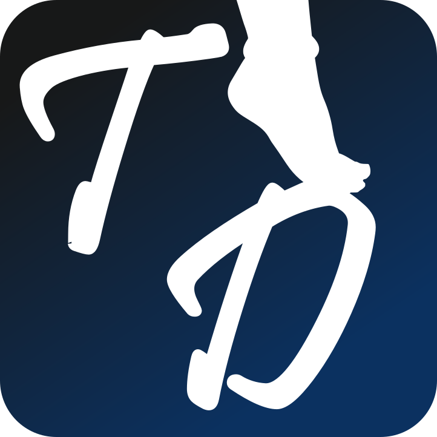
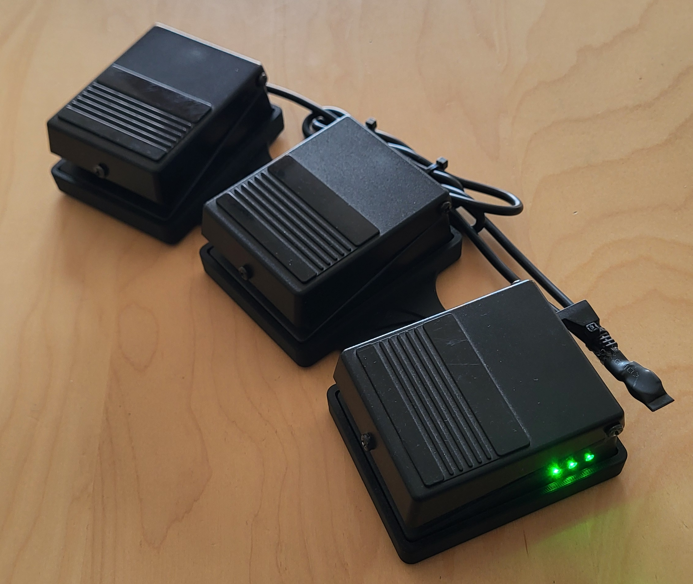
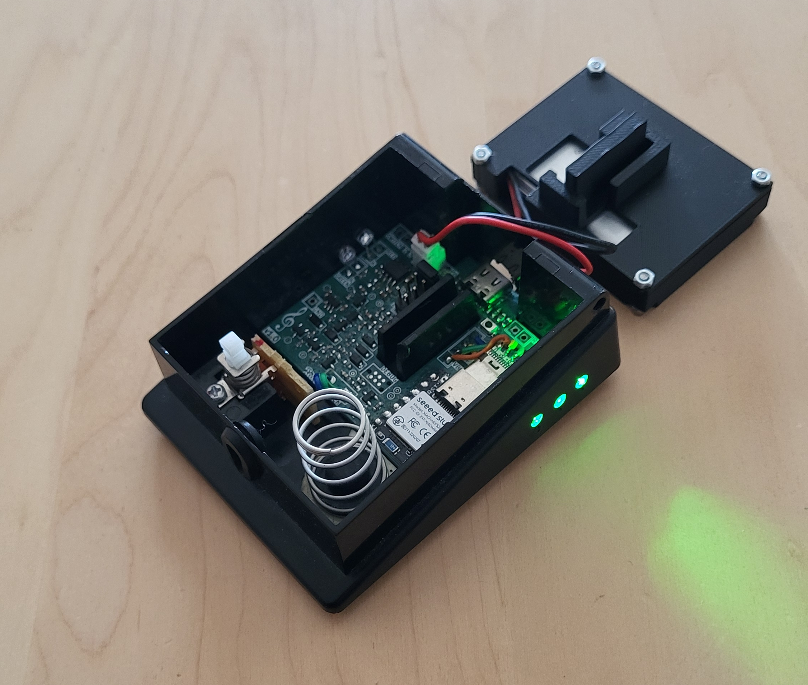
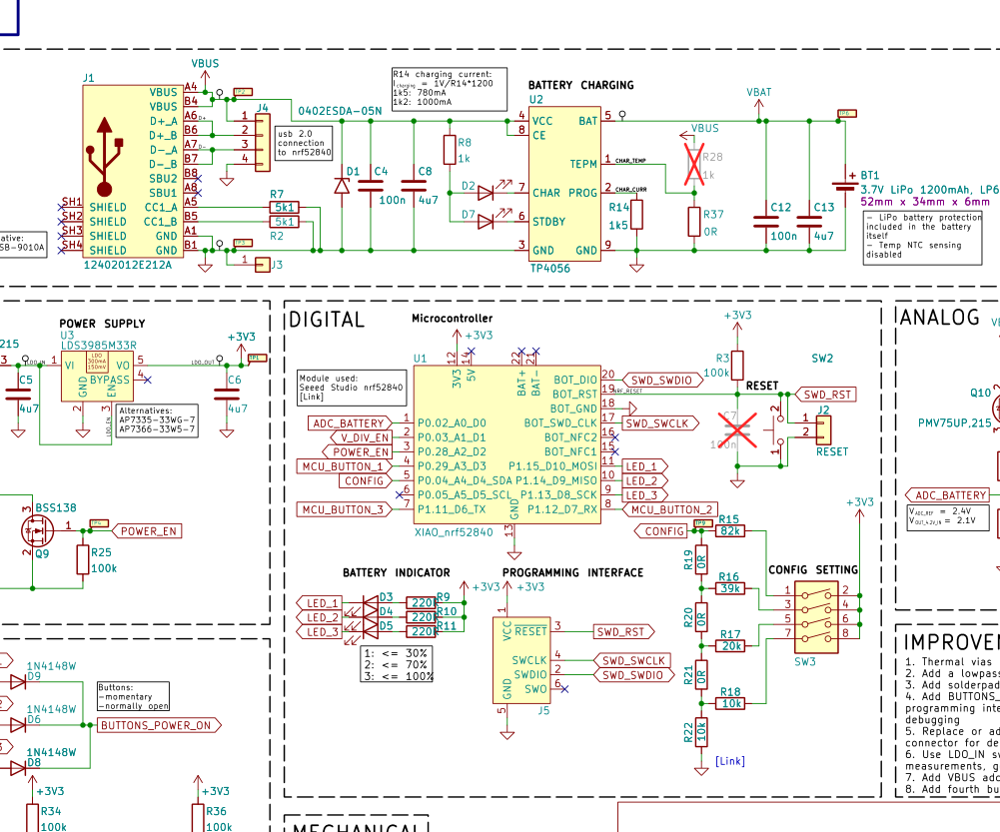
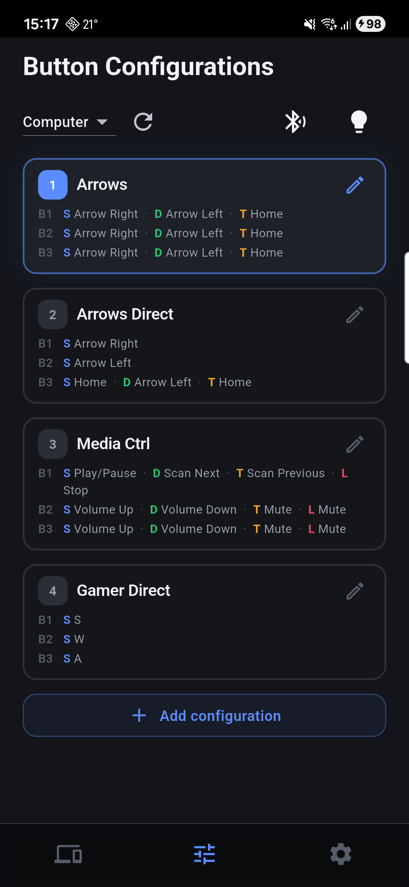

<div align="center">
  
</div>

<h1 align="center">TapDancer</h1>

<p align="center">
  A three-button Bluetooth LE footswitch for musicians. It turns pages in sheet-music apps, sends media keys and triggers keyboard shortcuts, so both hands stay on the instrument.
</p>

<p align="center">
  
  
  
  
</p>

<div align="center">
  <table>
    <tr>
      <td></td>
      <td></td>
    </tr>
    <tr>
      <td><a href="pcb/tapdancer_v1.0/outputs/schematic/tapdancer_v1.0.pdf"></a></td>
      <td><a href="pcb/tapdancer_v1.0/"></a></td>
    </tr>
  </table>
</div>

## Contents

- [Contents](#contents)
- [Overview](#overview)
- [Features](#features)
- [Specifications](#specifications)
- [Repository layout](#repository-layout)
- [Hardware](#hardware)
- [Firmware](#firmware)
  - [Building and flashing](#building-and-flashing)
- [Companion app](#companion-app)
  - [Building the app](#building-the-app)
- [Release builds](#release-builds)
- [Assembly](#assembly)
- [Configuration protocol](#configuration-protocol)
- [Contributing](#contributing)
- [License](#license)

## Overview

TapDancer is an open-source footswitch based on the [Seeed Studio XIAO nRF52840](https://wiki.seeedstudio.com/XIAO_BLE/). It pairs with phones, tablets and computers as a standard BLE HID keyboard, so it works with any application that accepts keyboard or media keys: sheet-music readers, DAWs, presentation software, lyric prompters and so on.

Each of the three buttons recognizes single, double, triple and long presses, and every gesture can be mapped to a key using the companion app. Up to 16 configurations are stored on the device, so no phone is needed once the pedal is set up.

The PCB sits inside an off-the-shelf Roland DP-2 sustain pedal. The repository contains everything needed to build one: the KiCad project, 3D-printable mounting parts, the PlatformIO firmware and the Flutter app.

## Features

- Three footswitches, each with four configurable gestures (single, double, triple and long press)
- Any key, modifier combination or consumer/media key can be assigned to a gesture
- 16 configurations stored on the device; optionally selectable in hardware with jumpers (R2R DAC)
- Up to four simultaneous host connections
- Standard BLE pairing and bonding
- Three LEDs for battery level, configuration changes and the auto-off countdown
- Configurable auto-off after inactivity (10 minutes by default)
- Around 370 hours of connected runtime on a 1200 mAh cell; 0.16 µA when off
- Companion app for Android, iOS, Windows, macOS and Linux

## Specifications

| | |
| --- | --- |
| MCU | Nordic nRF52840 (Seeed XIAO nRF52840) |
| Connectivity | Bluetooth LE, HID keyboard and consumer control |
| Buttons | 3, with 4 gestures each |
| Stored configurations | 16 |
| Simultaneous connections | Up to 4 |
| Battery | Li-ion / LiPo, approx. 1200 mAh typical |
| Current draw | 3.2 mA connected, 10 mA advertising, 0.16 µA off |
| Connected runtime | Approx. 370 h at 1200 mAh |
| Auto-off | Configurable, 10 min default |
| Hardware revision | v1.0.0 |

Power measurements and the R2R DAC calculations are in [`pcb/tapdancer_v1.0/measurements/`](pcb/tapdancer_v1.0/measurements/).

## Repository layout

```text
app/            Flutter companion app (Android, iOS, Windows, macOS, Linux)
firmware/       PlatformIO firmware for the XIAO nRF52840, patched bootloader
pcb/            KiCad project, Gerbers, BOM and plots (tapdancer_v1.0)
mechanical/     3D-printable battery mount and drilling template
.github/        GitHub Actions workflow for release builds
```

## Hardware

TapDancer v1.0 is a four-layer PCB designed in KiCad. Its outline fits inside a [Roland DP-2](https://www.roland.com/global/products/dp-2/) sustain pedal, which is inexpensive, robust and easy to find. Schematic, layout, footprints, Gerbers and BOM are in [`pcb/tapdancer_v1.0/`](pcb/tapdancer_v1.0/).

| Block | Part / notes |
| --- | --- |
| MCU / BLE | Seeed Studio XIAO nRF52840 (nRF52840, Cortex-M4F, BLE 5) |
| Enclosure | Roland DP-2 sustain pedal |
| Buttons | 3 footswitches (primary, secondary, tertiary) |
| Indicators | 3 LEDs (battery, config, status) |
| Battery | 1200 mAh LiPo cell |
| Power | TP4056 charger, LDS3985 LDO, software-controlled power enable and battery voltage divider |
| Configuration select | R2R DAC and jumpers, producing 16 discrete ADC levels |
| Connectors | 3.5 mm jack (PJ392A), Roland DP-2 sustain-pedal footprint |

Fabrication outputs (e.g. for JLCPCB):

- Gerbers: [`pcb/tapdancer_v1.0/outputs/gerber/`](pcb/tapdancer_v1.0/outputs/gerber/)
- Interactive BOM: [`outputs/bom/bom_tapdancer_v1.0.html`](pcb/tapdancer_v1.0/outputs/bom/bom_tapdancer_v1.0.html)
- Schematic PDF: [`outputs/schematic/tapdancer_v1.0.pdf`](pcb/tapdancer_v1.0/outputs/schematic/tapdancer_v1.0.pdf)

References: [nRF52840 Product Specification](https://docs.nordicsemi.com/bundle/ps_nrf52840/page/keyfeatures_html5.html), [Seeed XIAO nRF52840 wiki](https://wiki.seeedstudio.com/XIAO_BLE/), [USB HID Usage Tables](https://usb.org/document-library/hid-usage-tables-15).

## Firmware

The firmware is a PlatformIO project using the Arduino framework on the Adafruit nRF52 core.

- Board `xiaoble_adafruit`, SoftDevice S140 v7.3.0
- Configurations stored in LittleFS on internal flash (approx. 28 kB)
- BLE services: HID keyboard and consumer control, Battery Service, Nordic UART Service (configuration)

The device requires a patched Adafruit nRF52 bootloader (0.9.2 with one fix that makes BLE OTA updates work). The patch and prebuilt binaries are in [`firmware/bootloader/`](firmware/bootloader/).

### Building and flashing

```bash
git clone https://github.com/UCSIG/TapDancer.git
cd TapDancer/firmware

pio run                 # build
pio run -t upload       # flash via nrfutil (default upload protocol)
pio device monitor      # serial console, 115200 baud
```

A new board needs the bootloader flashed first. See [`firmware/bootloader/README.md`](firmware/bootloader/README.md) and the notes at the top of [`firmware/platformio.ini`](firmware/platformio.ini).

## Companion app

The app is used to pair devices, edit configurations and update firmware.

<table>
  <tr>
    <td align="center"><b>2 simultaneous devices</b></td>
    <td align="center"><b>Button configurations</b></td>
    <td align="center"><b>Settings</b></td>
  </tr>
  <tr>
    <td></td>
    <td></td>
    <td></td>
  </tr>
</table>

With the app you can:

- Scan for, pair and connect to one or more TapDancers
- Assign a key (with modifiers) or media key to each gesture
- Name, reset and delete the 16 configuration slots
- Adjust double-click and long-press timing per button. A double-click time of `0` enables direct mode, where a press fires immediately.
- Change device settings: auto-off timeout, maximum number of connections, identify (blink) and factory reset
- Export and import configurations as `.tdcfg` files, either a single configuration or all 16 at once
- Restore earlier configurations from automatic backups. The app saves a backup of the device's configurations each time it connects (the last 20 per device), so an accidental overwrite can be undone.
- Update the firmware over BLE with the firmware bundled in the app (Android, iOS and macOS)

The app is written in Flutter and uses [`universal_ble`](https://pub.dev/packages/universal_ble) for Bluetooth on all platforms.

### Building the app

Requires Flutter 3.

```bash
cd app
flutter pub get

flutter run                # run on a connected device or desktop

flutter build apk          # Android
flutter build ipa          # iOS
flutter build windows      # Windows
flutter build macos        # macOS
flutter build linux        # Linux
```

Bluetooth permissions and entitlements are already configured in the platform projects.

The app bundles a firmware package for OTA updates in [`app/assets/firmware/`](app/assets/firmware/). After changing the firmware, run [`app/scripts/sync_firmware.ps1`](app/scripts/sync_firmware.ps1) to rebuild it and copy it into the app. [`app/scripts/build_release.ps1`](app/scripts/build_release.ps1) does this and then builds the Android and Windows release files locally.

## Release builds

The [Build](.github/workflows/release.yml) workflow builds the firmware, the Android APK and the Windows app on GitHub Actions. The firmware is built first and bundled into both apps, so each release ships with matching firmware.

- **Manual run:** Actions → Build → Run workflow. The results are available as workflow artifacts.
- **Release:** push a tag that matches the app version in [`app/pubspec.yaml`](app/pubspec.yaml), for example:

  ```bash
  git tag v1.2.0
  git push origin v1.2.0
  ```

  The workflow then creates a draft release containing the APK, the Windows zip and the firmware as `.zip` (DFU), `.hex` and `.uf2`. Review the draft and publish it.

## Assembly

1. Get a Roland DP-2 sustain pedal to use as the enclosure.
2. Order the PCB using the Gerbers in [`pcb/tapdancer_v1.0/outputs/gerber/`](pcb/tapdancer_v1.0/outputs/gerber/), either bare or assembled. The [interactive BOM](pcb/tapdancer_v1.0/outputs/bom/bom_tapdancer_v1.0.html) helps with placement.
3. Solder the XIAO nRF52840, footswitches, LEDs, battery protection and connectors.
4. 3D print the battery mount from [`mechanical/`](mechanical/), which holds the cell inside the housing:
   - `TapDancer v1.0 LiPo Plate.stl`
   - `TapDancer v1.0 LiPo Cover.stl`
5. Drill the housing for the LEDs and buttons using `mechanical/TapDancer v1.0 Drilling Template.pdf`.
6. Flash the bootloader and firmware (see [Firmware](#firmware)).
7. Mount the PCB in the pedal and set it up with the [companion app](#companion-app).

> [!WARNING]
> Check the polarity of the battery plug before connecting it. Many cells are sold with reversed JST polarity. Compare against the silkscreen and re-pin the connector if necessary; a reversed cell can destroy the board.

## Configuration protocol

Once paired, the pedal sends standard HID reports, so the host treats it like any Bluetooth keyboard. Each gesture maps to either a keyboard report (modifiers plus key codes) or a consumer control code.

The active configuration is selected from the app or, if jumpers are fitted, by the R2R DAC: the firmware reads the ADC voltage and picks one of 16 configurations by threshold. Battery voltage is measured through a divider, reported via the BLE Battery Service and shown on the LEDs at startup.

The app communicates with the device over the Nordic UART Service using a short, CRC-checked command format (`G#…` get, `S#…` set, `P#…` push). The implementation is in [`app/lib/utils/ble_command.dart`](app/lib/utils/ble_command.dart) and [`firmware/src/command.h`](firmware/src/command.h).

## Contributing

Issues and pull requests are welcome. For larger changes, please open an issue first.

- The command protocol is shared between firmware and app. Keep [`firmware/src/settings.h`](firmware/src/settings.h) and [`app/lib/models/device_settings.dart`](app/lib/models/device_settings.dart) in sync.
- Record changes in [`CHANGELOG.md`](CHANGELOG.md) following [Keep a Changelog](https://keepachangelog.com/) and [Semantic Versioning](https://semver.org/).

## License

| Part | License |
| --- | --- |
| Firmware ([`firmware/`](firmware/)) and app ([`app/`](app/)) | [MIT](LICENSE) |
| PCB ([`pcb/`](pcb/)) and enclosure parts ([`mechanical/`](mechanical/)) | [CERN-OHL-P-2.0](LICENSE-HARDWARE) |

---

<sub>Designed and built by UCSIG. Developed since 2024.</sub>
