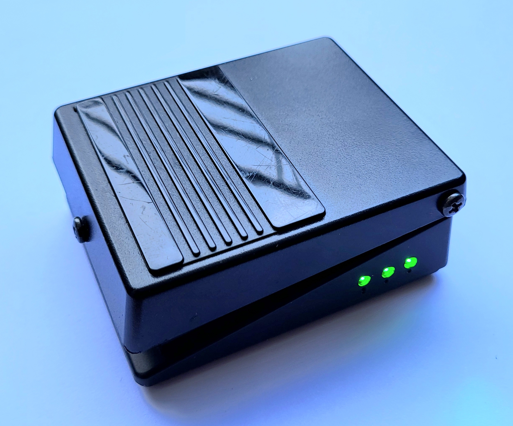
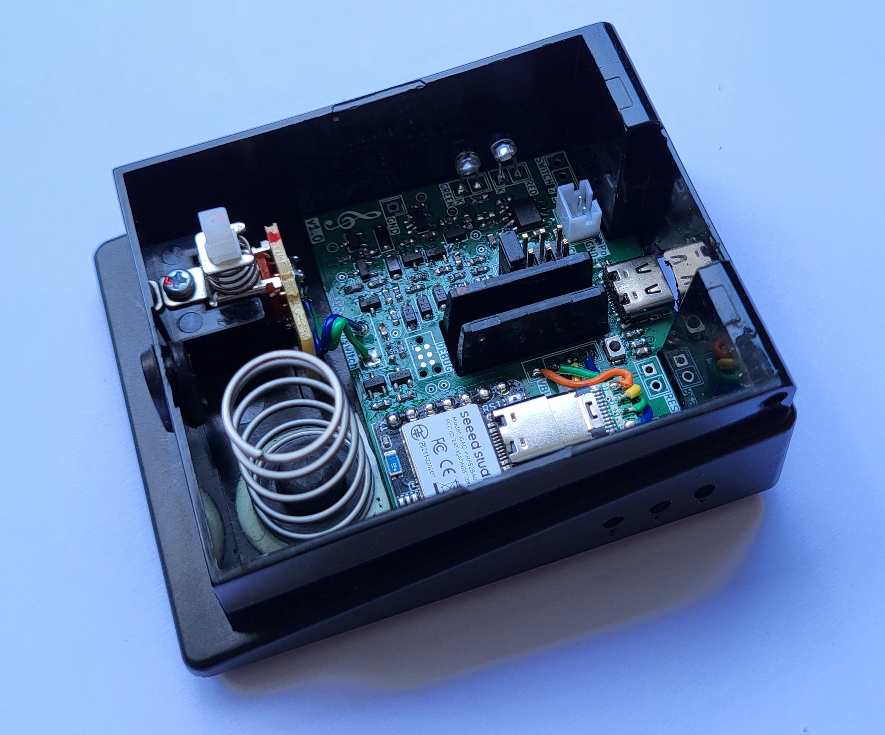
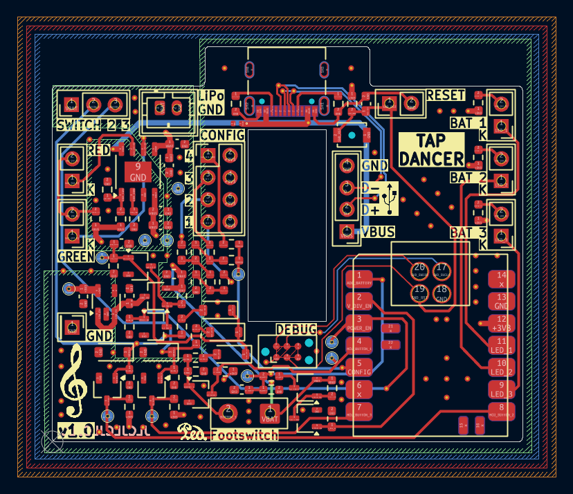
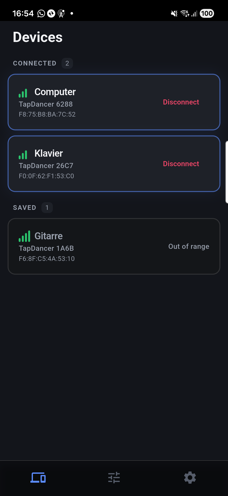
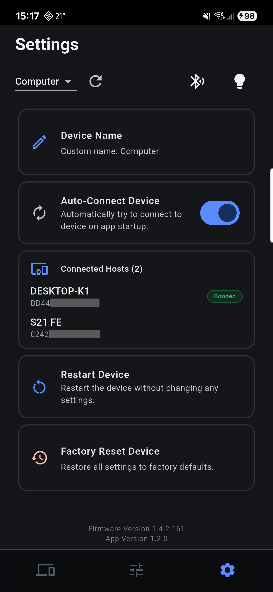

<div align="center">
  
</div>

<h1 align="center">TapDancer</h1>

<p align="center">
  A hands-free, three-button Bluetooth LE footswitch for musicians — turn sheet-music pages, trigger media keys, and send any keyboard shortcut without lifting your hands from your instrument.
</p>

<p align="center">
  
  
  
  
  
</p>

<div align="center">
  <table>
    <tr>
      <td></td>
      <td></td>
    </tr>
    <tr>
      <td><a href="pcb/tapdancer_v1.0/outputs/schematic/tapdancer_v1.0.pdf"></a></td>
       <td><a href="pcb/tapdancer_v1.0/"></a></td>
    </tr>
  </table>
</div>

---

## Table of Contents

- [Table of Contents](#table-of-contents)
- [Overview](#overview)
- [Features](#features)
- [Repository Layout](#repository-layout)
- [Companion App](#companion-app)
- [Hardware](#hardware)
- [Firmware](#firmware)
  - [Build \& flash](#build--flash)
- [Building the App](#building-the-app)
- [Assembly](#assembly)
- [How It Works](#how-it-works)
- [Specifications](#specifications)
- [Contributing](#contributing)
- [License](#license)

---

## Overview

TapDancer is an open-source BLE footswitch built around the [Seeed Studio XIAO nRF52840](https://wiki.seeedstudio.com/XIAO_BLE/). It connects to phones, tablets, and computers over Bluetooth Low Energy and appears as a standard **BLE HID keyboard**, so it works with any app that responds to keyboard or media keys — sheet-music readers, DAWs, slide decks, lyric prompters, and more.

Every button's **single / double / triple / long press** can be mapped to any keyboard or media key through the cross-platform [Flutter companion app](#companion-app). Up to **16 configurations** are stored on the device itself, so once it's set up the pedal works standalone — no phone required during a performance.

The whole project is open: the **KiCad PCB**, **3D-printable enclosure parts**, **PlatformIO firmware**, and **Flutter app** source are all in this repository.

## Features

- 🎹 **Hands-free page turning** — three foot-operated buttons for sheet music, lyrics, and tabs.
- ⌨️ **Full HID keyboard** — map any key, modifier combination, or media/consumer key to each gesture.
- 👆 **Four gestures per button** — single, double, triple, and long press are individually configurable.
- 💾 **16 on-device configurations** — switch between setups for different apps or instruments.
- 🔀 **Hardware config selection** — optional jumpers select a config via an on-board R2R DAC, no app needed.
- 📱 **Cross-platform app** — Android, iOS, Windows, macOS, and Linux from a single Flutter codebase.
- 🔗 **Multi-host** — connect to up to **4 hosts simultaneously** and manage several footswitches from one app.
- 🔋 **Long battery life** — ~370 h of connected runtime on a 1200 mAh cell; ~0.16 µA in deep sleep.
- 🔒 **Bonded & secure** — standard BLE pairing/bonding with on-device confirmation.
- 🪫 **Battery & status LEDs** — three LEDs show battery level, config changes, and auto-off countdown.
- ⏻ **Auto-off** — configurable inactivity timeout (default 10 min) to preserve battery.

## Repository Layout

```text
.
├── 📁 app/              # Flutter companion app (Android, iOS, Windows, macOS, Linux)
├── 📁 firmware/         # PlatformIO firmware for the XIAO nRF52840 + patched bootloader
├── 📁 pcb/              # KiCad project, gerbers, BOM, plots (tapdancer_v1.0)
├── 📁 mechanical/       # 3D-printable enclosure parts + drilling template
├── 📁 docs/             # Design calculations (R2R DAC for config selection)
└── 📁 measurements/     # Power-consumption measurements
```

## Companion App

The companion app handles pairing, configuration, and firmware management.

<table>
  <tr>
    <td align="center"><b>Devices</b></td>
    <td align="center"><b>Button Configurations</b></td>
    <td align="center"><b>Settings</b></td>
  </tr>
  <tr>
    <td></td>
    <td></td>
    <td></td>
  </tr>
</table>

**What you can do:**

- **Scan, pair, and connect** to one or more TapDancers (Devices screen).
- **Map keys** — assign a keyboard or media key (with modifiers) to each button's single/double/triple/long press.
- **Name and manage** the 16 configuration slots; delete or reset them.
- **Tune button timing** — double-click and long-press durations per button (a double-click time of `0` enables *direct mode*, firing instantly on a single press).
- **Device settings** — auto-off timeout, maximum simultaneous BLE connections, blink/identify, factory reset, and OTA-friendly reset.

Built with **Flutter** + **Riverpod**, using [`universal_ble`](https://pub.dev/packages/universal_ble) for cross-platform Bluetooth.

## Hardware

TapDancer v1.0 is a custom four-layer PCB designed in **KiCad**, built to drop into an off-the-shelf **[Roland DP-2](https://www.roland.com/global/products/dp-2/) sustain pedal** — a sturdy, widely available footswitch enclosure that costs only a few dollars/euros. The full PCB project — schematic, layout, footprints, gerbers and BOM — lives in [`pcb/tapdancer_v1.0/`](pcb/tapdancer_v1.0/).

| Block | Part / Notes |
| --- | --- |
| **MCU / BLE** | Seeed Studio XIAO nRF52840 (Nordic nRF52840, Cortex-M4F + BLE 5) |
| **Enclosure** | Repurposed **Roland DP-2** sustain pedal (cheap, off-the-shelf) — the PCB is shaped to fit inside it |
| **Buttons** | 3 × footswitches (primary / secondary / tertiary) |
| **Indicators** | 3 × LEDs (battery, config, status) |
| **Battery** | Li-Ion / LiPo cell (e.g. 18500, ~1200 mAh) with `bq297xx` protection |
| **Power** | On-board DC-DC; LDS3985 LDO; software-controlled power-enable and battery voltage divider |
| **Config selection** | R2R DAC + jumpers → 16 discrete ADC voltage levels select the active config |
| **Connectors** | 3.5 mm jack (PJ392A) / Roland DP-2 sustain-pedal footprint |

Key reference material: [nRF52840 Product Specification](https://docs.nordicsemi.com/bundle/ps_nrf52840/page/keyfeatures_html5.html), [Seeed XIAO nRF52840 wiki](https://wiki.seeedstudio.com/XIAO_BLE/), [TI bq297xx datasheet](https://www.ti.com/product/BQ2970), [USB HID Usage Tables](https://usb.org/document-library/hid-usage-tables-15). Third-party 3D models (XIAO, Roland DP-2, LEDs) are not included, so the KiCad 3D viewer shows those parts without a model.

**Production outputs** (ready for fabrication, e.g. JLCPCB):

- Gerbers: [`pcb/tapdancer_v1.0/outputs/gerber/`](pcb/tapdancer_v1.0/outputs/gerber/)
- Interactive BOM: [`outputs/bom/bom_tapdancer_v1.0.html`](pcb/tapdancer_v1.0/outputs/bom/bom_tapdancer_v1.0.html)
- Schematic PDF: [`outputs/schematic/tapdancer_v1.0.pdf`](pcb/tapdancer_v1.0/outputs/schematic/tapdancer_v1.0.pdf)

## Firmware

The firmware is a **PlatformIO** project using the Arduino framework for the Adafruit nRF52 core. It implements the BLE HID keyboard, battery service, and a Nordic UART–based command protocol for the app.

- **Board:** `xiaoble_adafruit` · **SoftDevice:** S140 v7.3.0
- **Click detection:** [`Button2`](https://github.com/LennartHennigs/Button2) (single/double/triple/long)
- **Storage:** LittleFS on internal flash (~28 kB) stores all 16 configs
- **Services:** HID keyboard + consumer control, Battery (BAS), Nordic UART (NUS) for configuration
- **Reliability:** 3 s watchdog, up to 4 concurrent connections, configurable auto-off

A patched **Adafruit nRF52 bootloader** (0.9.2 + one fix that makes BLE OTA updates work) ships as a patch plus prebuilt binaries, see [`firmware/bootloader/`](firmware/bootloader/).

### Build & flash

```bash
git clone https://github.com/UCSIG/TapDancer.git
cd TapDancer/firmware

# Build and upload (PlatformIO)
pio run                 # build
pio run -t upload       # flash via nrfutil (default upload protocol)
pio device monitor      # serial console @ 115200 baud
```

A fresh board needs the matching bootloader flashed first — see [`firmware/bootloader/README.md`](firmware/bootloader/README.md) and the notes at the top of [`firmware/platformio.ini`](firmware/platformio.ini).

## Building the App

The app targets Flutter 3 (Dart SDK `^3.6.1`).

```bash
cd app
flutter pub get

# Generate Riverpod code
dart run build_runner build --delete-conflicting-outputs

# Run on a connected device / desktop
flutter run

# Or build a release for your platform
flutter build apk          # Android
flutter build ipa          # iOS
flutter build windows      # Windows
flutter build macos        # macOS
flutter build linux        # Linux
```

> **Note:** BLE requires runtime permissions on Android/iOS and Bluetooth capability entitlements on desktop — these are already configured in the platform projects.

## Assembly

1. **Get a Roland DP-2 pedal** — TapDancer reuses this cheap, off-the-shelf sustain pedal as its enclosure.
2. **Fabricate the PCB** from the gerbers in [`pcb/tapdancer_v1.0/outputs/gerber/`](pcb/tapdancer_v1.0/outputs/gerber/) (or order assembled). Use the [interactive BOM](pcb/tapdancer_v1.0/outputs/bom/bom_tapdancer_v1.0.html) to place parts.
3. **Solder** the XIAO nRF52840, footswitches, LEDs, battery protection, and connectors.
4. **3D-print** the battery-mounting parts from [`mechanical/`](mechanical/) (they hold the LiPo cell inside the DP-2 housing):
   - `TapDancer v1.0 LiPo Plate.stl`
   - `TapDancer v1.0 LiPo Cover.stl`
5. **Drill the DP-2 housing** for the LEDs/buttons using `mechanical/TapDancer v1.0 Drilling Template.pdf`.
6. **Flash the bootloader and firmware** (see [Firmware](#firmware)).
7. **Fit the PCB into the DP-2** and **configure** the device with the [companion app](#companion-app).

> ⚠️ **IMPORTANT — check the polarity of the LiPo plug before connecting the battery.** Many cells ship with reversed JST polarity; verify against the silkscreen and re-pin the connector with pliers if it's wrong. Connecting a reversed cell can destroy the board.

## How It Works

- The footswitch advertises as a **BLE HID keyboard** and, once paired, sends standard key reports — so the host treats it like any Bluetooth keyboard.
- Each **button gesture** (single/double/triple/long) maps to an HID keyboard report (modifier + up to several keycodes) or a **consumer/media key**.
- The active **configuration** is chosen either from the app or — if jumpers are fitted — by the **R2R DAC**: the firmware reads one of 16 discrete ADC voltage thresholds and selects the matching config.
- The app talks to the device over the **Nordic UART Service** using a compact, CRC-checked command protocol (`G#…` get, `S#…` set, `P#…` push). See [`app/lib/utils/ble_command.dart`](app/lib/utils/ble_command.dart) and [`firmware/src/command.h`](firmware/src/command.h).
- The on-board **voltage divider + ADC** measure battery voltage; the level is broadcast via the BLE Battery Service and shown on the LEDs at startup.

## Specifications

| | |
| --- | --- |
| MCU | Nordic nRF52840 (Seeed XIAO nRF52840) |
| Connectivity | Bluetooth LE — HID keyboard + consumer control |
| Buttons | 3, with 4 gestures each (single/double/triple/long) |
| On-device configs | 16 |
| Simultaneous connections | Up to 4 |
| Battery | Li-Ion / LiPo (~1200 mAh typical) |
| Current draw | ~3.2 mA connected · ~10 mA advertising · ~0.16 µA off |
| Connected runtime | ~370 h @ 1200 mAh |
| Auto-off | Configurable, 10 min default |
| Hardware revision | v1.0.0 |

## Contributing

Contributions are welcome! Please open an issue to discuss substantial changes first. When contributing:

- **Firmware** — keep constants in [`firmware/src/settings.h`](firmware/src/settings.h) and the app's [`app/lib/models/device_settings.dart`](app/lib/models/device_settings.dart) in sync (the command protocol is shared between them).
- **App** — run `dart run build_runner build` after touching Riverpod providers, and `flutter analyze` before submitting.
- See [`CHANGELOG.md`](CHANGELOG.md) and follow [Keep a Changelog](https://keepachangelog.com/) / [Semantic Versioning](https://semver.org/).

## License

| Part | License |
| --- | --- |
| Firmware ([`firmware/`](firmware/)) and app ([`app/`](app/)) | [MIT](LICENSE) |
| Hardware: PCB ([`pcb/`](pcb/)) and enclosure parts ([`mechanical/`](mechanical/)) | [CERN-OHL-P-2.0](LICENSE-HARDWARE) |

Third-party components keep their own licenses:

| Component | License |
| --- | --- |
| [`firmware/lib/SerialCommand`](firmware/lib/SerialCommand/) ([Arduino-SerialCommand](https://github.com/kroimon/Arduino-SerialCommand)) | LGPL-3.0 |
| [`app/third_party/universal_ble`](app/third_party/universal_ble/) (vendored and patched) | BSD-3-Clause |
| [`firmware/bootloader/bin`](firmware/bootloader/bin/) (Adafruit nRF52 Bootloader, Nordic SoftDevice S140) | MIT, Nordic 5-Clause |

---

<sub>Designed and built by UCSIG · Developed since 2024, the public history starts with firmware v1.4.2 · Firmware v1.4.2 · App v1.2.0 · Hardware v1.0.0</sub>
